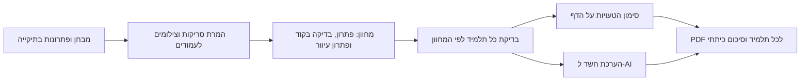

<div align="center">

<pre>
   _______
  /       \      ____                             _      ___
 /  \ | /  \    |  _ \    ___     ___    ___     / \    |_ _|
|  -- O --  |   | |_) |  / _ \   / _ \  / _ \   / _ \    | |
 \  / | \  /    |  _ &lt;  | (_) | |  __/ |  __/  / ___ \   | |
  \_______/     |_| \_\  \___/   \___|  \___| /_/   \_\ |___|
</pre>

# Exam Check for Teachers

**A Claude Code skill that grades a class set of handwritten physics exams from scans or phone photos: a score for every student, every error circled on the student's own page with a short Hebrew reason, and an evidence-based estimate of AI use.**


</div>

<div dir="rtl">

## מה צריך לעשות? שלושה צעדים

1. **מתקינים פעם אחת.** פותחים את Claude Code בתיקייה של הפרויקט שלכם ומדביקים את הודעת ההתקנה (בהמשך העמוד).
2. **שמים את המבחן, דף הנוסחאות והפתרונות בתיקייה אחת.** אפשר לבקש מהסקיל לפתוח לכם תיקייה מוכנה. את המבחן
   או הבוחן ואת דף הנוסחאות שמים בתיקייה עצמה, ואת הסריקות או הצילומים של התלמידים בתת-תיקייה בשם
   **פתרונות**: קובץ PDF אחד לכל תלמיד, או תיקייה עם הצילומים של כל תלמיד.
3. **מבקשים בדיקה.** כותבים למשל "תבדוק את המבחנים בתיקייה בדיקות מבחן תלמידים", עונים על כמה שאלות קצרות
   (איפה הקבצים, מחוון, ואיך להוריד נקודות), ומקבלים את כל המבחנים בדוקים.

כך נראית התיקייה:

</div>

```text
📁 מבחן אלקטרוסטטיקה             ← תיקייה אחת לכל מבחן
├── 📄 מבחן.pdf                   ← המבחן (PDF, Word או צילומים)
├── 📄 מחוון.pdf                  ← לא חובה: הפתרון שלכם
├── 📄 דף נוסחאות.pdf             ← מומלץ: דף הנוסחאות (או תיקייה בשם נוסחאון)
├── 📁 פתרונות                    ← העבודות של התלמידים
│   ├── 📄 דני כהן.pdf
│   ├── 📁 נועה לוי               ← או תיקייה עם צילומים מהטלפון
│   └── 📄 יוסי 1.jpg, יוסי 2.jpg
└── 📁 בדיקה                      ← כאן הסקיל שומר את התוצאות
```

<div dir="rtl">

## מה מקבלים

| קובץ | מה יש בו |
|---|---|
| 📝 `<שם התלמיד> - בדוק.pdf` | דף ציון (ציון 0-100, ניקוד לכל סעיף, כל הורדה וסיבתה), ואחריו דפי התלמיד עצמם: כל טעות מוקפת באדום, ולידה הנקודות שירדו וסיבה של 4-5 מילים |
| 🤖 חשד לשימוש ב-AI | לכל תלמיד ציון 0-100 (100 = כמעט בוודאות נפתר עם בינה מלאכותית), עם הסימנים לכאן ולכאן, ובחשד גבוה גם שאלות לשיחה קצרה עם התלמיד |
| 📊 `סיכום ציונים.pdf` | ממוצע, חציון, התפלגות, טבלת ציונים, הטעויות הנפוצות בכיתה, ותלמידים עם חשד ל-AI |
| 📋 `סיכום ציונים.csv` | אותה טבלה לאקסל או לגיליון הציונים |
| ✅ `מחוון.pdf` | המחוון שלפיו נבדק המבחן, עם הניקוד לכל סעיף וכללי ההורדה שבחרתם |

## כללי הורדת הניקוד

**לפני שהבדיקה מתחילה, הסקיל שואל קודם איפה הקבצים, ואז איך להוריד נקודות**, בשלושה סבבים קצרים של שאלות.
בכל שאלה האפשרות
הראשונה היא הכלל המקובל, ואפשר גם לכתוב כלל משלכם (למשל "חוסר נימוק: 2 נקודות"):

1. איפה המבחן או הבוחן, דף הנוסחאות והמבחנים הסרוקים (הסקיל יכול לפתוח לכם תיקייה מוכנה)
2. האם יש מחוון, ואם לא, האם להראות לכם את המחוון שהסקיל בונה לפני הבדיקה
3. כמה להוריד כשחסר נימוק בסעיף שביקש לנמק
4. כמה להוריד על טעות חישוב כשהדרך נכונה
5. מה לעשות כשתלמיד ענה על יותר שאלות מהנדרש (רק כשיש שאלות בחירה)
6. כמה להוריד כשתלמיד לא התחיל מהנוסחה כפי שהיא מופיעה בדף הנוסחאות
7. כמה להוריד על שימוש ב-g = 9.8 במקום 10
8. כמה להוריד על יחידות חסרות או שגויות
9. האם טעות נגררת נספרת פעם אחת או בכל סעיף
10. כמה שווה תשובה סופית נכונה בלי דרך
11. האם להוריד על מספר או צעד בלי הסבר מאיפה הגיעו

מה שבחרתם נרשם במחוון, מודפס בראש `מחוון.pdf`, ומופעל על כל התלמידים באותה צורה. מקרים שלא נשאלתם עליהם
נבדקים לפי כללי ברירת המחדל, בסגנון בגרות:

| מצב | הורדה |
|---|---|
| חסר נימוק כשהשאלה ביקשה "נמקו" או "הסבירו" | חצי מהסעיף |
| טעות חישוב, הדרך נכונה | נקודה אחת |
| יחידות חסרות או שגויות בתשובה הסופית | חצי נקודה |
| לא התחיל מהנוסחה כפי שהיא מופיעה בדף הנוסחאות (הציב ישר בנוסחה מסודרת מחדש) | נקודה אחת בכל סעיף |
| שימוש ב-g = 9.8 במקום 10 (הערך המקובל בכיתה) | נקודה אחת בכל סעיף שבו הוצב |
| מספר או צעד בלי הסבר מאיפה הגיעו | נקודה אחת |
| טעות נגררת (שימוש נכון בתוצאה שגויה מסעיף קודם) | רק במקום שבו נעשתה |
| תשובה סופית נכונה בלי דרך או חישוב | חצי מהסעיף |
| סימן או כיוון שגויים כשהשאלה מבקשת אותם | 1-2 נקודות |
| נוסחה לא מתאימה, או נתון שנקרא לא נכון | חצי עד שלושה רבעים מהסעיף |
| חלק מהבקשה חסר (כיוון, זמן) | החלק היחסי של אותה בקשה |
| בחירה (אמריקאית, נכון/לא נכון) בלי הנימוק שהתבקש | עד חצי מהסעיף |
| תשובה שגויה בלי עבודה רלוונטית | כל הסעיף |
| סעיף שלא נענה | כל הסעיף |

**איך מחושב הציון:**
* כמה כל סעיף שווה: לפי הניקוד שמודפס במבחן.
* סעיף: הניקוד המלא פחות ההורדות, לא פחות מאפס. שאלה: סכום הסעיפים. ציון: סכום השאלות שנספרו, מעוגל.
* כל שלב שהתלמיד כתב מחושב מחדש, לא רק התשובה הסופית. תשובה נכונה אחרי חישוב שגוי מקבלת הורדה על טעות
  החישוב, ומסומנת לבדיקה שלכם (ייתכן שהתשובה הייתה ידועה מראש).
* החשבון של הציון נבדק בקוד לפני שנוצר PDF: אם משהו לא מסתכם, הקובץ לא נבנה.
* דרך פתרון אחרת ונכונה מקבלת ניקוד מלא, כל עוד היא מתחילה מנוסחה שבדף הנוסחאות.
* המחוון עצמו נבנה מהנוסחאות שבדף הנוסחאות ועם הקבועים שבו (ו-g = 10 אם לא נאמר אחרת), ולכל סעיף רשומה
  הנוסחה שממנה מתחילים. כתיב שקול מתקבל (למשל W = −qΔV במקום W = qV_AB, כי V_AB = −ΔV), אבל נוסחה שכבר
  נפתרה למשתנה אחר (למשל V = E·d כשבדף כתוב E = V/d) נחשבת התחלה שלא מהדף.
  אם אין דף נוסחאות בתיקייה, הסקיל משתמש בדף הנוסחאות הסטנדרטי של משרד החינוך ומוריד רק במקרים ברורים.
* אותה טעות מקבלת אותה הורדה ואותה סיבה אצל כל התלמידים.
* שורה שלא ניתן לקרוא לא נספרת לרעת התלמיד: היא מסומנת לבדיקה שלכם.

## איך זה עובד

</div>



<div dir="rtl">

* **מחוון מאומת קודם:** כל טעות במחוון הייתה חוזרת אצל כל התלמידים, ולכן הסקיל פותר את המבחן, מוודא כל מספר
  בקוד, ונותן לסוכן נפרד לפתור "עיוור" ולהשוות. אפשר לבקש לראות ולאשר את המחוון לפני הבדיקה.
* **אותה טעות, אותה הורדה:** רשימת הורדות משותפת לכל הכיתה, וטעות נגררת נספרת פעם אחת בלבד.
* **הסימון במקום הנכון:** לכל עמוד נוצרת רשת קואורדינטות, וכל טעות מסומנת לפי הרשת, ואז נבדקת בעין על הדף המוכן.
* **בדיקת הציון:** סכום הסעיפים, הציון הסופי ואורך הסיבות נבדקים בקוד לפני שנוצר PDF.
* **כיתה גדולה:** כל תלמיד נבדק בידי סוכן נפרד, במקביל, ואחר כך משווים את אותו סעיף בין כל התלמידים.

## על ציון החשד ל-AI

הציון נשען על דרך הפתרון: טעויות אישיות וחוסר עקביות, מחיקות, קיצורי דרך וסעיפים שלא הושלמו מעידים על עבודה
עצמית; ניסוח אחיד כמו בספר, תשובות מלאות לכל בקשה, קבועים מדויקים מדי, שיטות מחוץ לחומר, וטעויות אופייניות
למודלים מעידים על שימוש ב-AI. זו **הערכה ולא הוכחה**. בחשד גבוה הסקיל מציע שאלות לשיחה קצרה על הצעדים של
התלמיד עצמו: מי שפתר בעצמו מסביר אותם מיד.

## פרטיות

עבודות התלמידים נשארות במחשב שלכם, בתוך תיקיית הפרויקט. הסקיל לא מעלה דפים או שמות לשום מקום. אם הפרויקט
מנוהל ב-git, ודאו שתיקיית המבחנים מופיעה ב-.gitignore.

## התקנה (בתוך הפרויקט, לא גלובלית)

להדביק ב-Claude Code, מתוך תיקיית הפרויקט:

</div>

```text
התקן בפרויקט הזה את הסקיל exam-check-for-teachers: שכפל את https://github.com/roeea2/exam-check-for-teachers
לתוך התיקייה .claude/skills/exam-check-for-teachers של הפרויקט (לא בהתקנה גלובלית), ובדוק ש-Python 3.10+,
Google Chrome ו-poppler מותקנים. אמור לי אם חסר משהו.
```

<div dir="rtl">

או מהטרמינל, מתוך תיקיית הפרויקט:

</div>

```bash
git clone https://github.com/roeea2/exam-check-for-teachers.git .claude/skills/exam-check-for-teachers
```

<div dir="rtl">

אחר כך פותחים מחדש את Claude Code בתיקיית הפרויקט. מדריך של עמוד אחד להדפסה:
[docs/exam-check-guide.pdf](docs/exam-check-guide.pdf).

## שימוש

</div>

```text
תבדוק את המבחנים בתיקייה "מבחן אלקטרוסטטיקה"
תבדוק את המבחנים לפי המחוון שבתיקייה, בהקפדה כמו בבגרות
תבדוק אם התלמיד בתיקייה הזו השתמש ב-AI במבחן
/exam-check-for-teachers
```

<div dir="rtl">

רוצים לשנות? כותבים במילים פשוטות, למשל "בשאלה 2א תוריד רק נקודה אחת לכולם", והסקיל מעדכן את כל התלמידים
ובונה מחדש את הקבצים.

## דרישות

Python 3.10 ומעלה · Google Chrome או Chromium · poppler (`pdftoppm`, `pdftotext`, `pdfinfo`) · חיבור לאינטרנט
בזמן הבנייה (הגופן Heebo). צילומי HEIC מומרים עם `sips` של macOS; מבחן ב-Word צריך LibreOffice (או לשמור כ-PDF).

## מבנה המאגר

</div>

```text
SKILL.md                     ההוראות ל-Claude: התיקייה, השאלות, המחוון, הבדיקה, הדוחות
scripts/find_exam.py         מאתר את המבחן, המחוון והעבודות של כל תלמיד
scripts/prepare_pages.py     ממיר סריקות וצילומים לעמודים ויוצר רשת קואורדינטות
scripts/annotate.py          בודק את הציון ובונה PDF עם הטעויות מסומנות על הדף
scripts/report.py            סיכום כיתתי (PDF ו-CSV) והמחוון כ-PDF
references/                  כללי ניקוד, סימון, זיהוי AI ומבני הנתונים
docs/                        מדריך של עמוד אחד
```

## In English

Exam Check for Teachers is a project-scoped [Claude Code](https://claude.com/claude-code) skill for physics
teachers who grade in Hebrew. The teacher puts one exam and many students' scanned or photographed solutions in a
folder. The skill builds an answer key and verifies it (every number recomputed in code, plus an independent blind
solve), grades each student by the exam's points with consistent deductions and error-carried-forward, circles
every error on the student's own page with the points and a 4-5 word Hebrew reason, and estimates for each student
how likely the exam was solved with an AI model (0-100, with the evidence and questions for a short talk). It
writes a marked PDF per student and a class summary (PDF and CSV). Student work never leaves the teacher's machine.
Install it inside a project with
`git clone https://github.com/roeea2/exam-check-for-teachers.git .claude/skills/exam-check-for-teachers`.

## License

[MIT](LICENSE) © 2026 RoeeAI.
